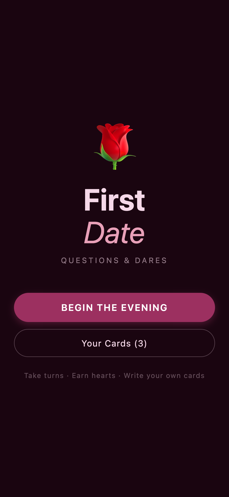
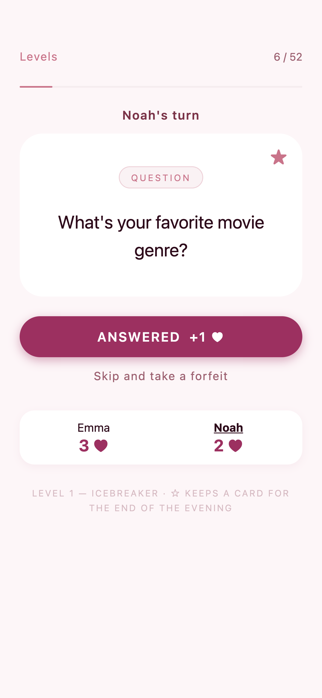
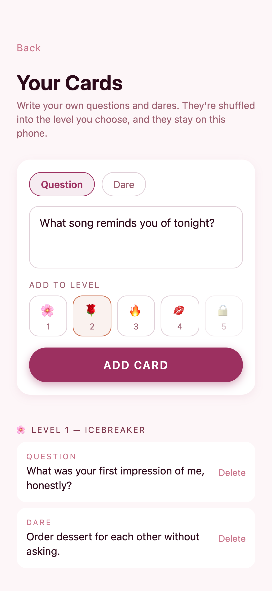
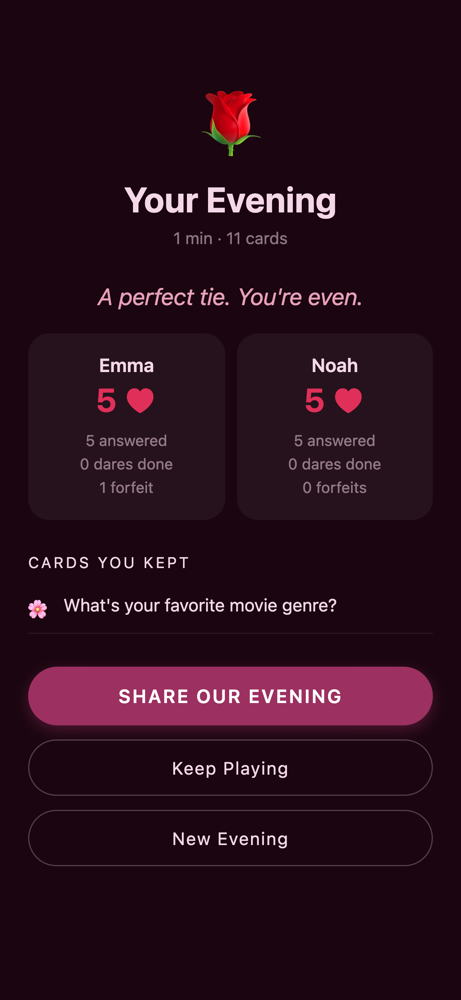

# First Date: Questions & Dares

A card game for two adults, played face to face on one phone. Two players take turns with questions and dares across five levels, from light icebreakers to adults-only. Answering a question earns one heart and finishing a dare earns two. Skipping a card means taking a forfeit instead. When the evening ends, the app shows a summary of how it went.

<p>
  
  
  
  
</p>

## Features

- Two named players take turns, and the app keeps the score.
- 250 built-in cards spread over five levels, shuffled each time a level is played.
- Skipping a card draws a forfeit, mild on levels 1–2 and flirtier from level 3.
- Your Cards lets players write their own questions and dares and choose the level they belong to. These cards are stored only on the device.
- Tapping the star keeps a card. End Evening then shows hearts, dares, forfeits and the kept cards, and the summary can be shared.
- Levels 1–4 are free. Level 5 is a one-time in-app purchase through StoreKit, with Restore Purchase.
- There are no accounts, no ads and no tracking, and the game works offline.

## Tech

- [Expo](https://expo.dev) SDK 58, React Native 0.88 and TypeScript
- [`expo-iap`](https://github.com/hyochan/expo-iap) handles the non-consumable in-app purchase, which is simulated in Expo Go during development.
- `@react-native-async-storage/async-storage` stores player names and custom cards on the device.
- EAS Build and EAS Submit handle App Store builds and TestFlight.

| File | What it holds |
|---|---|
| [`App.tsx`](App.tsx) | The screens and game logic: players, turns, score, forfeits, custom cards and the summary |
| [`content.ts`](content.ts) | The card decks, the forfeits and the shuffled deck builder |
| [`purchases.ts`](purchases.ts) | Unlocking level 5 with the in-app purchase |
| [`storage.ts`](storage.ts) | Storage on the device |
| [`store/`](store) | App Store text, screenshots, and the support and privacy pages |

## Running it

```bash
npm install
npx expo start
```

Open the app in Expo Go, or press `w` to run it in a browser. In development the purchase screen runs in test mode, and no real payment is made.

## Status

Submitted to the App Store in November 2026. Support and privacy policy: [olaimalm.github.io/firstdate-support](https://olaimalm.github.io/firstdate-support/).

## License

© 2026 Olai Malm. All rights reserved. The code is published for viewing. It may not be copied, redistributed or published as an app without permission.
